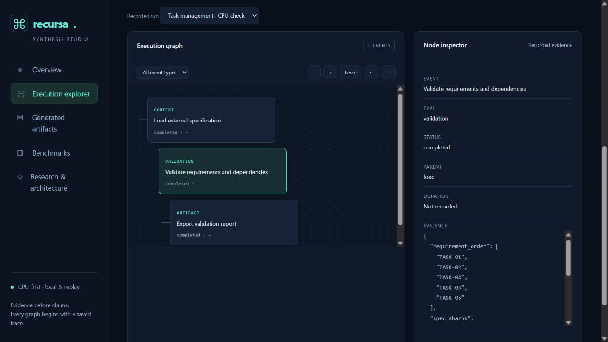

# Recursa — Recursive Application Synthesis

A CPU-first research workbench for inspecting application specifications, execution traces, and artifacts. The current implementation provides a local replay Studio, resumable specification checks, and an official RLM adapter tested with scripted offline responses. **Genuine model-backed synthesis and baseline comparisons remain unverified; the full application-generation pipeline is unfinished.** No research advantage is claimed.

Implementation follows the [ordered 1–21 progress record](docs/implementation-progress.md). Sections 1–3 have been reviewed; section 4 has offline integration evidence, and section 5's source-verification foundation is being implemented. Real-model verification remains open. Earlier frontend/compute work does not bypass P0.



Published development preview: [Recursa Studio on Hugging Face](https://huggingface.co/spaces/jacobroutzong/recursa) · [Portfolio project](https://jacobroutzong.dev/projects/recursa/) · [Source](https://github.com/jacobhroutzong/recursa). Production page, embed, fallback and internal portfolio links were verified in the browser. The public demo is replay-only. Build progress refreshes every 15 seconds and changes after a release is published, not with each private engineering action.

## Run locally

Python 3.11+ is the only requirement. No pip installation, API key, Node build, or GPU is needed.

On Windows, `./scripts/start.ps1` runs the CPU check and starts Studio in one command. It uses Codex's bundled Python when present, avoiding the Windows Store Python alias. Pass `-PythonExecutable` to select another interpreter. The cross-platform equivalent is:

```powershell
python -m recursa.experiments --config configs/smoke.json --output runs
python -m recursa.server
```

Open http://127.0.0.1:7860. The recorded CPU check validates unique requirement IDs, dependency references and acyclicity, saves a topological order and source/spec fingerprint, and exports a report. It does not generate an application or invoke a model. Repeating the first command reuses completed checkpoints with the same source/config/spec fingerprint. Interrupted CPU trials can rerun safely. Failed and timed-out trials remain preserved; use a new output directory for an explicit retry.

The first command prints the batch directory. Inside are `manifest.json`, per-trial `checkpoint.json` and `run.json`, `metrics.csv`, and `recursa-artifacts.zip`. Import a `run.json` into Studio or place it under the server's `--runs` directory. ZIP files are transport bundles; extract them before importing the individual run JSON.

## Existing-subscription compute strategy

Develop locally on Windows; the smoke workflow uses CPU and no accelerator dependencies. The RTX 4070 Laptop's 8 GB VRAM is a constrained optional resource, not a default allocation. Reserve substantial inference, fine-tuning and evaluation for interactive Colab Pro sessions after the live runtime and budgets are verified. Hugging Face hosts a CPU-only replay frontend and versioned public artifacts; no GPU upgrade is requested. Remote inference APIs require separate authorization and finite limits. HF Pro and ChatGPT/Codex subscriptions are not treated as unlimited inference credits.

### Colab: upload once, then Run all

```powershell
python scripts/package_source.py
```

Upload `recursa-source.zip` to your Google Drive, open `notebooks/recursa_colab.ipynb` in Colab, and use **Run all**. The notebook mounts Drive interactively, extracts the allowlisted source archive, and runs the exact repository command with durable Drive output. Defaults expect `MyDrive/Recursa/recursa-source.zip`. There is no manual copying of source cells or recurring environment rebuild; this stdlib workflow has no dependencies to install. Update the source archive when code changes; fingerprints prevent stale checkpoint reuse.

This notebook was generated and structurally checked locally; execution inside an authenticated Colab session has not been tested. It does not select GPUs, guarantee availability, launch an inference server, or automate session creation. See [compute policy](docs/compute.md).

## Verification

```powershell
python -m unittest discover -s tests -v
```

Tests cover dependency errors, actual CPU execution/export/resume, fingerprint invalidation, timeout checkpoint handling, invalid budgets and path traversal. The HTTP service exposes replay data only. Imported source is displayed as inert text, never executed. `--host 0.0.0.0` is intended only for replay deployment.

For optional official-runtime offline tests, create an isolated Python 3.11+ environment and install `requirements-live.lock`, then run the same test command from that environment. These tests intercept model HTTP traffic with scripted responses and contact no inference provider. See [runtime verification](docs/runtime-verification.md). Without these dependencies, runtime integration cases are skipped. On Windows, `.venv/Scripts/python.exe -m unittest discover -s tests -v` uses the prepared environment. Node.js enables non-executing JavaScript syntax checks; TypeScript/build/browser tests are reported unmeasured until configured. The batch CLI continues to reject genuine live inference under the owner's offline-first instruction.

Optional TypeScript verification uses `npm ci --ignore-scripts --prefix tooling/typecheck` and the pinned TypeScript 5.9.3 package. Pass its `node_modules/typescript` directory to `check_sources(..., typescript_directory=...)`, or set the local adapter's `typescript_compiler_directory`. See [the verification boundaries](docs/typechecking.md). Offline checks include actual production builds, Chromium interactions and export unit cases, fixed AST lint rules, basic accessibility audits and a deliberately broken behavior followed by a scripted repair and full recheck. These use human-authored fixtures; they are not evidence of model generation or model-backed repair.

For the optional one-command application check, install the pinned frontend/browser dependencies once, then run `python -m recursa.offline --output runs/task-fixture-001`. It validates/lints TypeScript, bundles the task app and runs six authored unit cases plus four interaction scenarios with basic accessibility audits. See [application verification](docs/application-verification.md) for setup, boundaries, durable reports and remaining section-5 work. The public demo continues to serve recorded evidence only.

Release test counts and source hashes appear in the published progress dashboard. CPU experiment execution and checkpoint reuse are verified alongside each release.

## Deployment preparation

`Dockerfile` serves Studio, release progress and allowlisted public captures under `traces/public` on port 7860 without inference dependencies. The owner authorized publication on October 29, 2026. Both GitHub and Hugging Face logins were verified against the intended owners. Never include provider logs, credentials or private specifications in a public bundle. This container is a replay viewer, not an execution sandbox.

The deployment record is maintained in [the ordered progress ledger](docs/implementation-progress.md). Portfolio changes preserve the existing Astro site, add a dedicated project page and link it from Selected projects and Projects. Only normal fast-forward publication is used; unrelated content and infrastructure are preserved.

To publish an updated Space release after authorization, run `python scripts/verify.py`, then `python scripts/prepare_release.py`. The latter produces `.cache/release-location.json` pointing at an allowlisted payload directory. Upload that directory with `hf upload jacobroutzong/recursa <payload> . --type space`; never upload the entire workspace. The packager rejects stale test evidence. Recheck `hf auth whoami` before each publication session.

## Architecture and remaining research work

`recursa.engine` validates external structured specifications. `recursa.experiments` executes bounded worker processes and preserves per-trial evidence. `recursa.server` exposes recorded evidence to `apps/studio/index.html`. The Studio provides trace filtering, inspection, stepping, zoom, source export and run import. Source and config hashes identify reproducibility inputs; output timings naturally vary across machines.

The target research runtime is the official [RLM project](https://github.com/alexzhang13/rlm), based on [Recursive Language Models](https://arxiv.org/abs/2512.24601) by Alex L. Zhang, Tim Kraska and Omar Khattab. External context and real model-backed subcalls remain the required next vertical slice. The default CPU validator is deterministic orchestration, not RLM inference. The local upstream REPL must not be exposed publicly or considered a sandbox.

The adapter now supports reviewed application verification and focused repair under shared call/token/cost reservations and an elapsed-time deadline; an intercepted-transport regression proves the wiring without genuine inference. The offline fixture command accepts `--max-wall-seconds` and retains measured partial stages on exhaustion. Next: verify the outer process/OS boundary and a genuine authorized inspection/subcall/artifact run using the installed, pinned runtime. Fair direct/structured baselines follow the working core. Open-weight model loading, GPU checkpoint continuation, fine-tuning, baselines, genuine model replays and statistical evaluation remain outstanding. Current resume is **between trials**, not inside an interrupted model/training process.
