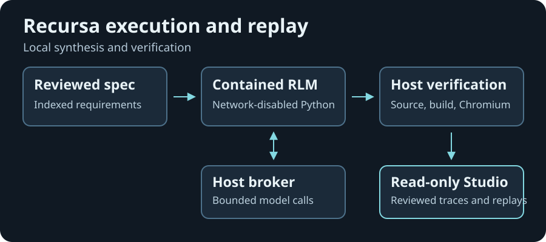

# Recursa architecture

Recursa uses the official `rlms==0.1.3` runtime (Python import `rlm`). Python 3.11+ and the standard library are sufficient for CPU smoke runs and the replay server. The research lane adds the pinned SDK, a local Linux Docker engine, Node.js and Chromium.

| Boundary | Implementation and evidence |
| --- | --- |
| Reviewed specification | [engine](../recursa/engine.py) validates stable requirement IDs and dependencies. [context](../recursa/context.py) provides indexed inspection. [taskgraph](../recursa/taskgraph.py) records dependency-aware synthesis state. |
| Model-controlled execution | [container_rlm](../recursa/container_rlm.py) invokes the official completion loop with the specification as external context. [sandbox](../recursa/sandbox.py) verifies the pinned image and network-disabled, non-root container policy before dispatch. |
| Host request broker | [Host broker](host-broker.md) describes bounded private pipes and host-owned usage reservations. Provider configuration stays on the host. The authorized Qwen run recorded requirement inspection and a completed subcall. |
| Artifact and verification pipeline | [artifacts](../recursa/artifacts.py) validates paths, hashes and requirement provenance. [pipeline](../recursa/pipeline.py) runs source checks, builds and declared browser acceptance. [repair](../recursa/repair.py) records bounded edits and rechecks. |
| Recorded evidence | [experiments](../recursa/experiments.py) saves CPU checkpoints and exports. [server](../recursa/server.py) serves allowlisted recordings and inspected source to [Studio](../apps/studio/index.html). The public host has replay routes only. |

The official runtime implements the completion loop and sub-model calls. Recursa adds specification inspection, resource limits, artifact handling, verification and replay. The host reserves usage before provider dispatch because provider reports and SDK accounting arrive after requests. The sandbox shares a kernel with its engine, and Chromium executes reviewed application candidates inside a separate browser boundary. See the [containment policy](container-sandbox.md) and [browser boundaries](application-verification.md).
